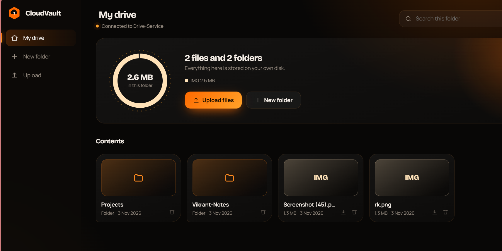
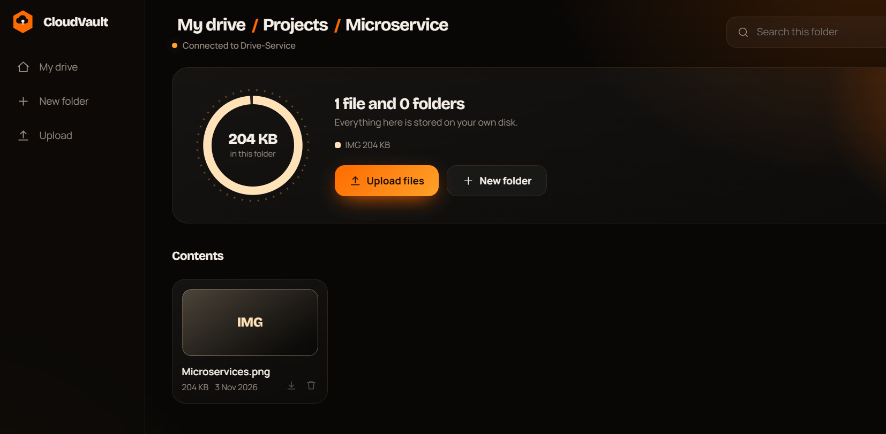
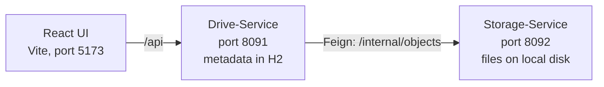

# CloudVault

A Google Drive-style file storage platform built with **Spring Boot microservices** and a **React** frontend. Upload files, organise them in nested folders, download them and delete them. File contents and file metadata live in two separate services.



## Features

- Nested folders with breadcrumb navigation
- File upload by button or drag and drop (10 MB per file)
- Download and delete for files and folders
- Search within the current folder
- Dashboard summary: file count, folder count and size by file type
- Clear error messages from the backend (for example, deleting a folder that is not empty)



## Architecture



| Service | Responsibility | Data |
| --- | --- | --- |
| **cloudvault-ui** | Dashboard, folder navigation, upload and download | None |
| **Drive-Service** | Public REST API, folders, file metadata, validation, upload lifecycle | H2 file database (`./data/drive`) |
| **Storage-Service** | Internal object store: put, get and delete bytes by ID | Local folder (`./data/objects`) |

The browser only talks to Drive-Service. Storage-Service is internal, and Drive-Service calls it through an OpenFeign client.

## Tech stack

- **Backend:** Java 21, Spring Boot 4.1.1, Spring Web MVC, Spring Data JPA, Bean Validation, OpenFeign, Actuator
- **Database:** H2 (file-based, persists across restarts)
- **Frontend:** React 18, Vite 5
- **Build:** Maven (wrapper included)

Both services include the Spring Cloud Eureka client dependency, with service discovery switched off for local runs (`eureka.client.enabled=false`). Drive-Service reaches Storage-Service through a configured URL.

## How uploads stay consistent

Metadata and file bytes live in different services, so an upload is a small two-step process:

1. Drive-Service saves the item as `PENDING`.
2. It sends the bytes to Storage-Service.
3. On success the item becomes `READY` and appears in listings.
4. If storage fails, Drive-Service deletes the stored object and the metadata row, so no half-finished upload remains.

Other design decisions:

- **Safe writes:** Storage-Service writes to a temporary file and then moves it into place, so a failed upload never leaves a partial file.
- **Concurrency:** pessimistic locking when changing a folder's contents and an `@Version` field on items to catch conflicting updates.
- **Delete lifecycle:** items move to `DELETING` before removal. A folder can only be deleted when it is empty (HTTP 409 otherwise).
- **Name validation:** rejects blank names, names over 255 characters, `.` and `..`, path separators and control characters.
- **Object IDs:** files are stored under a random UUID, never under the user's file name.

## API (Drive-Service, port 8091)

| Method | Endpoint | Description |
| --- | --- | --- |
| `GET` | `/api/items?parentId={uuid}` | List a folder. Leave out `parentId` for the root. |
| `POST` | `/api/folders` | Create a folder. Body: `{ "name": "Docs", "parentId": null }` |
| `POST` | `/api/files` | Upload. Multipart fields: `file`, `parentId` (optional) |
| `GET` | `/api/files/{id}` | Download a file |
| `DELETE` | `/api/items/{id}` | Delete a file or an empty folder |

Storage-Service exposes `PUT`, `GET` and `DELETE` on `/internal/objects/{id}`. It is meant for service-to-service calls only.

## Run it locally

**Requirements:** Java 21, Node.js 18 or newer

Start the services in this order, each in its own terminal:

```bash
# 1. Storage-Service (port 8092)
cd Storage-Service
./mvnw spring-boot:run

# 2. Drive-Service (port 8091)
cd Drive-Service
./mvnw spring-boot:run

# 3. Frontend (port 5173)
cd cloudvault-ui
npm install
npm run dev
```

On Windows PowerShell use `.\mvnw spring-boot:run`. Then open **http://localhost:5173**.

During development, Vite forwards `/api` to `http://localhost:8091`, so no CORS configuration is needed.

## Configuration

| Setting | Default | Where |
| --- | --- | --- |
| Drive-Service port | `8091` | `Drive-Service/src/main/resources/application.properties` |
| Storage-Service port | `8092` | `Storage-Service/src/main/resources/application.properties` |
| Storage URL used by Drive-Service | `http://localhost:8092` | `drive.storage.url` |
| Upload folder | `./data/objects` | `DRIVE_STORAGE_DIR` environment variable |
| Max file size | `10MB` | `spring.servlet.multipart.max-file-size` |

## Project structure

```
CloudVault/
  Drive-Service/      metadata, folders, public REST API
  Storage-Service/    internal object storage on local disk
  cloudvault-ui/      React + Vite frontend
```

## Limitations and roadmap

- No authentication yet. Planned: Spring Security with JWT and per-user drives.
- Files are stored on the local disk. Planned: a storage provider interface with an AWS S3 implementation.
- Not containerised yet. Planned: Dockerfiles and Docker Compose.
- Planned: starred files, trash and restore, sharing links, rename and move, a storage usage endpoint.
- Planned: Eureka service discovery and an API gateway.
- Planned: integration tests for the upload and delete flows.

## Author

**Vikrant More**
